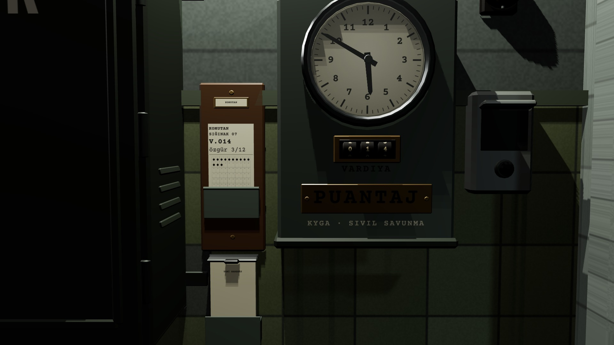
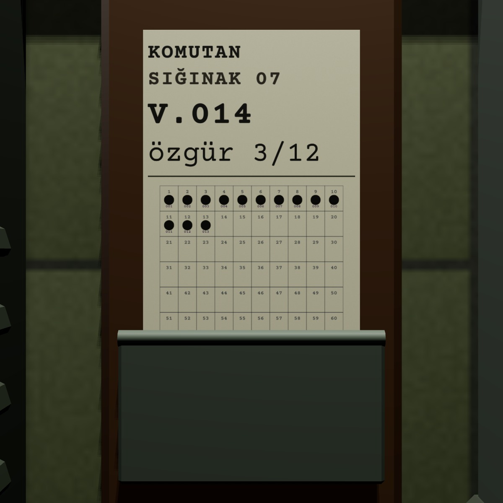

# R2 · Saat pozu (M2) ve kartın düzeni
*Pano: `R2.dc.html` · görüntü: `../panolar/R2.jpg`*

R2 · KARTIN DÜZENİ 90 × 184 MM · 1:1 ÖLÇÜLER

- **10 mm** — KOMUTAN · CP 700, 6,5 mm
- **21 mm** — SIĞINAK 07 · CP 700, 6,5 mm
- **36 mm** — V.014 · CP 700, 10 mm
- **52 mm** — özgür 3/12 · CP 400, 8,5 mm
- **60 mm** — çizgi 1,5 mm
- **70 mm** — ızgara 10 × 8, hücre 7,6 × 10,5; delik Ø 4,2 sekizgen, satır satır
- **alt** — paraf “K. — 07” Kalam, mavi

Ölçüler kartın üst kenarından. Kart cebe 46 mm girer: üst yedi satır görünür. 80 delikten sonra ekleme yok, doğruyu V.nnn söyler. EN: COMMANDER / SHELTER 07 / S.014 / free 3/12.
M2 · SAAT, RAF, DESTE TEK KADRAJ 42° · 1 PX ≈ 0,65 MM
Saat 0,07 m aşağı, raf 0,34 m'ye kısaldı, deste rafın hemen altında. Kamera (3,12 · 1,35 · −0,40) → (2,2 · 1,30 · −0,40).
1 Cepte kart: başlık + özet + ızgara 2 VARDİYA sayacı: 3 teker, masanın rakam dokusu 3 PUANTAJ pirinç plaka · KYGA · SİVİL SAVUNMA 4 Deste: 40 boş kart, yaylı kıskaç
