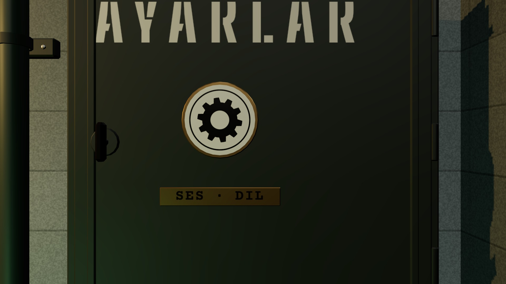

# R3a · Dolap kapalı · K1'den ve K9'da
*Pano: `R3a.dc.html` · görüntü: `../panolar/R3a.jpg`*

R3a · AYARLAR DOLABI KAPALI · K1'DEN UZAKTAN, K9'DA YAKINDAN ARKA DUVAR, CRT'NİN ÜSTÜ · MERKEZ (1,68 · 1,52 · 2,30)

*[görüntü: K1'den sağ üst köşe büyütülmüş: kapalı ayarlar dolabı, kanatta AYARLAR şablonu ve dişli rozet]*

*[görüntü: K1 tam kadraj küçük]*

K1 UZAKTAN · BİR BAKIŞTA “AYARLAR”
K1'de dolap sağ üst köşede ~360 px. Okunan üç şey: 62 mm krem şablon AYARLAR (~31 px), Ø 128 mm emaye dişli rozet, SES · DİL pirinç plakası. Üzerine gelince kanat 4 mm öne, 400 ms sonra etiket “AYARLAR · ses ve dil”.

K9 YAKINDAN · AÇILMADAN ÖNCEKİ KARE
Kamera K9'a 0,45 s'de varır; kanat bu karede kapalı, sonra mandal 0,15 s döner ve kanat 0,45 s'de −95° açılır. K9 çapası yerel z −0,86, dikey 45° (uygulanan); bu pozda 1 px ≈ 0,64 mm: pah 2 mm, ince parça ≥ 2 mm.
- Kasa · 680 × 700 × 220 mm sac, 5 mm pah, ön dudak, üst/alt panjur, duvar kulakları, kablo rakoru. | Kanat · kapı kanadının boyası paintOliveDark; menteşe sağda (Leaf, yerel y); mandal Latch ← Leaf (z 90°). | Yazılar · TXT_Stencil (Big Shoulders Stencil 800, krem #D8D2BE) · TXT_LeafPlate (Courier Prime 700). EN: SETTINGS · SOUND · LANGUAGE. | Işık · kapalıyken iç parçalar çizilmez, iç ampul kapalı; dolap odanın gölgeli ışıklarını almaz.
