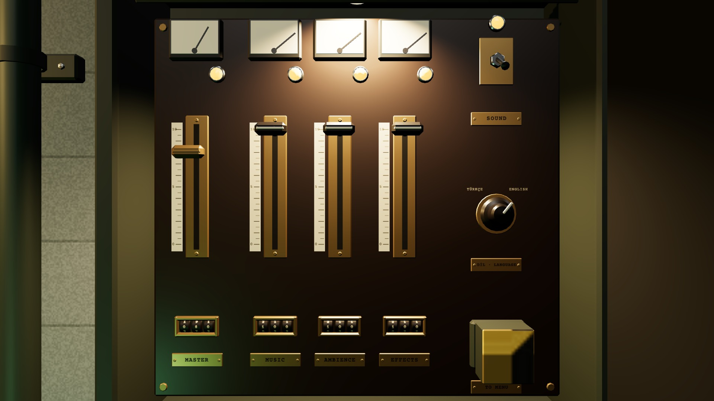

# R3c · Cabinet open · EN
*Pano: `R3c.dc.html` · görüntü: `../panolar/R3c.jpg`*

R3c · OPEN · EN K9 · 45°
Plates sized for English (80 mm): MASTER · MUSIC · AMBIENCE · EFFECTS · SOUND · TO MENU. The language plate stays bilingual: DİL · LANGUAGE. The rotary rests at −40° on ENGLISH.
AMBIENCE (8 letters) is the longest: at a 6.2 mm cap it fits the plate at ≥ 14 px in K9; the font is never shrunk.
MUSIC · 100% drag · wheel ±5%
