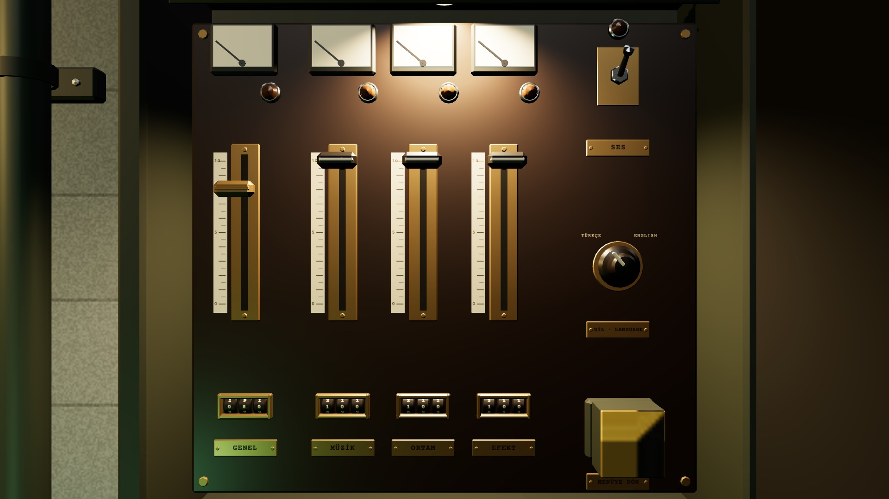
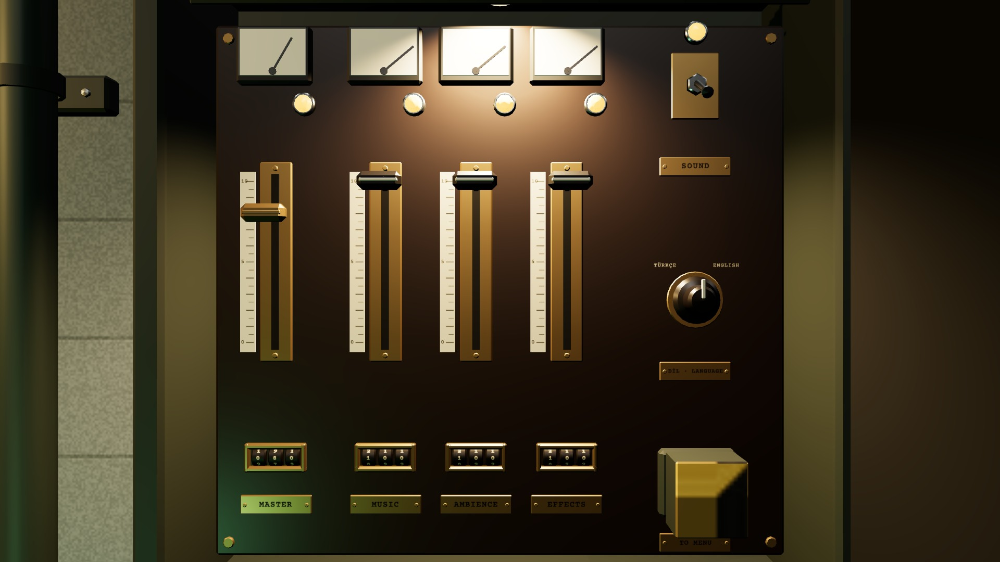

# R3d · Sessiz mod ve dil değişirken
*Pano: `R3d.dc.html` · görüntü: `../panolar/R3d.jpg`*

R3d · SESSİZ MOD · DİL DEĞİŞİRKEN HİÇBİR DURUM YALNIZ RENKLE VERİLMEZ

SESSİZ · SES ANAHTARI AŞAĞIDA
Kol −28° → +28° (aşağı = KAPALI), 0,08 s “klak”. Dört kanal lambası ve SES lambası söner (parlaklık + konum), ibreler +50°'ye düşer. Sürgüler ve sayaç tekerleri değeri korur; ses açılınca ibreler yaylı gecikmeyle geri gelir. Etiket: “SES · KAPALI”.

014/02 · LANGUAGE · ENGLISH
DİL DEĞİŞİRKEN · KADEME ANAHTARI ORTADA
Düğme +40° → −40° (0,12 s, “tak”); geçerken bütün plakalar ve etiketler bir karede yeni dile geçer (TMP). Teleks şeridi “LANGUAGE · ENGLISH” basar. Gün 0'da oyun dolap kapanınca yeni dilde yeniden kurulur (açıkken kurulmaz; açılış dizisi dolabı karartmasın).
