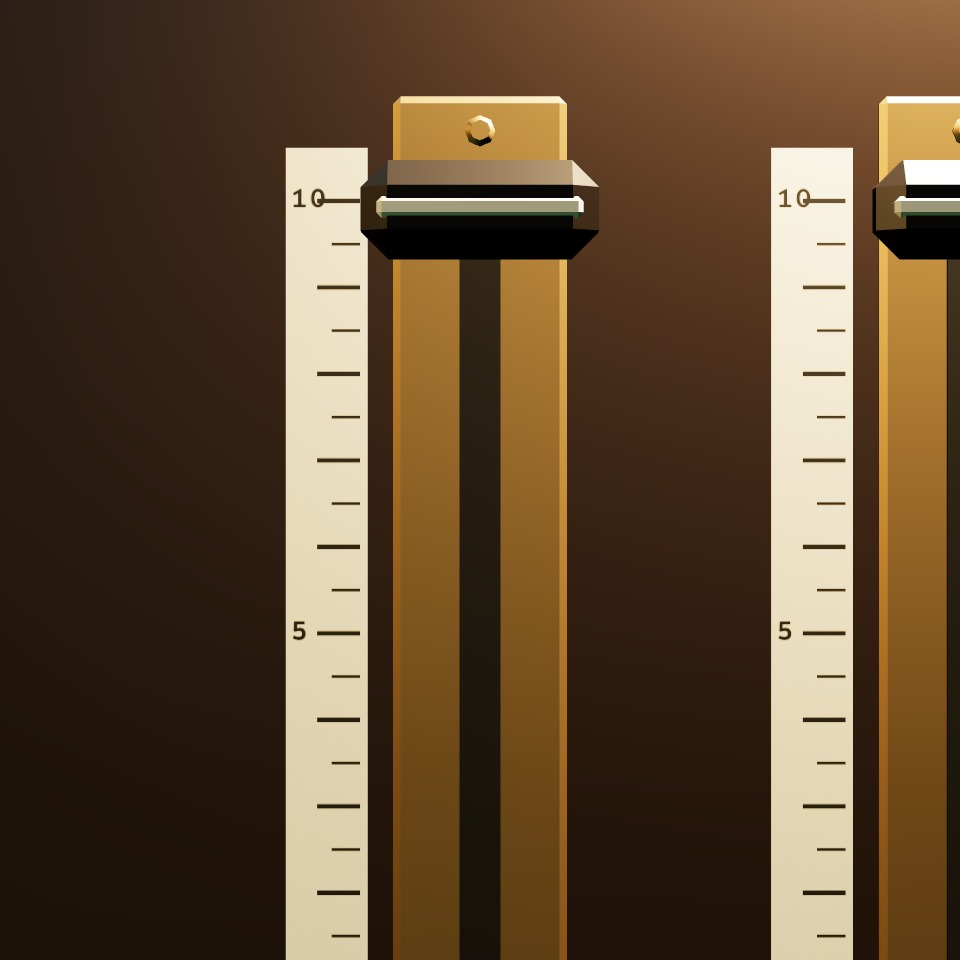
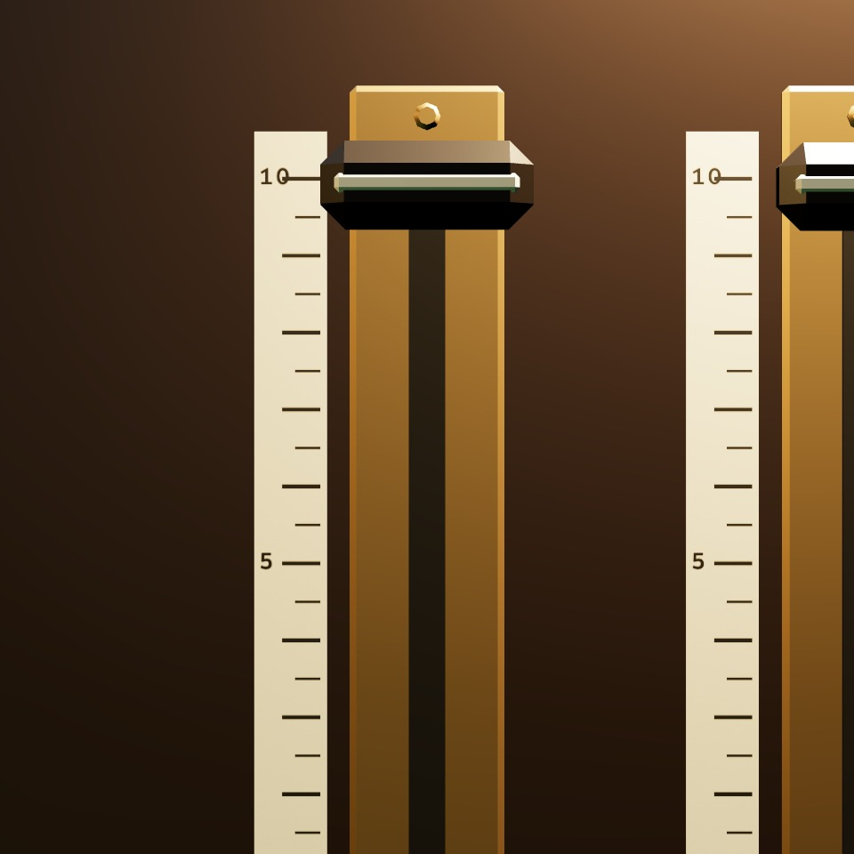
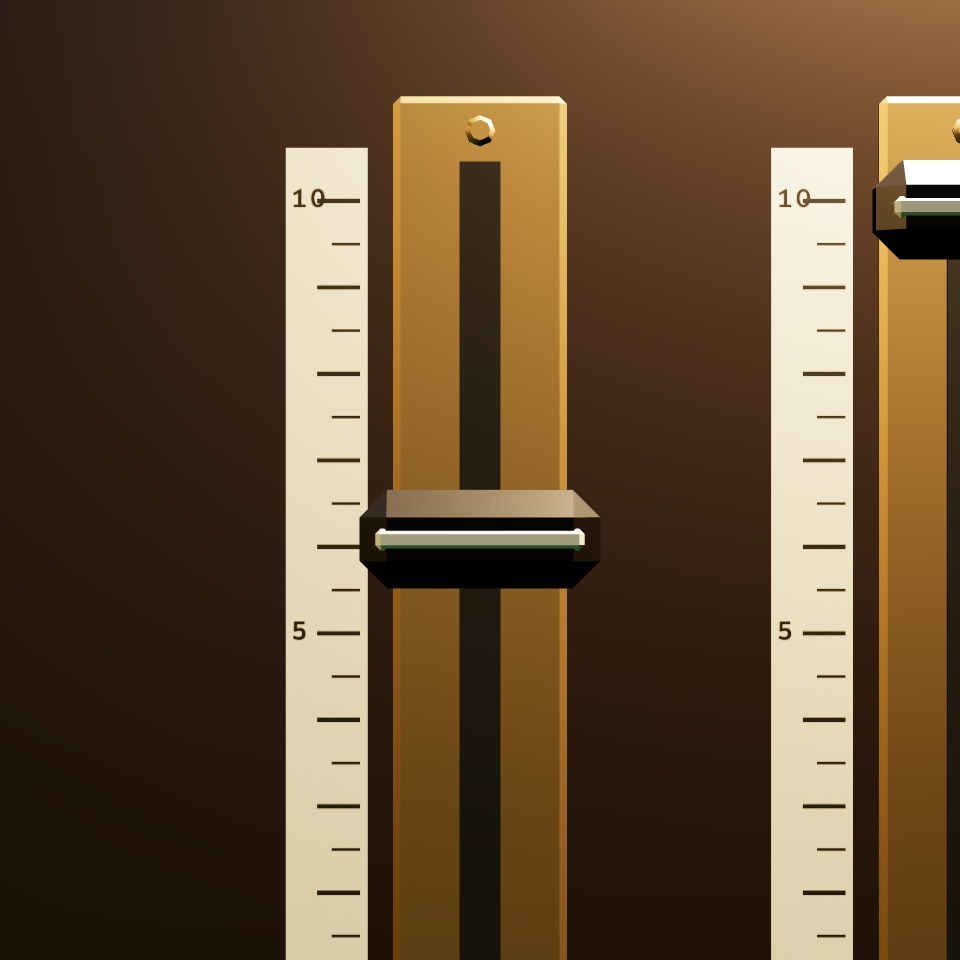
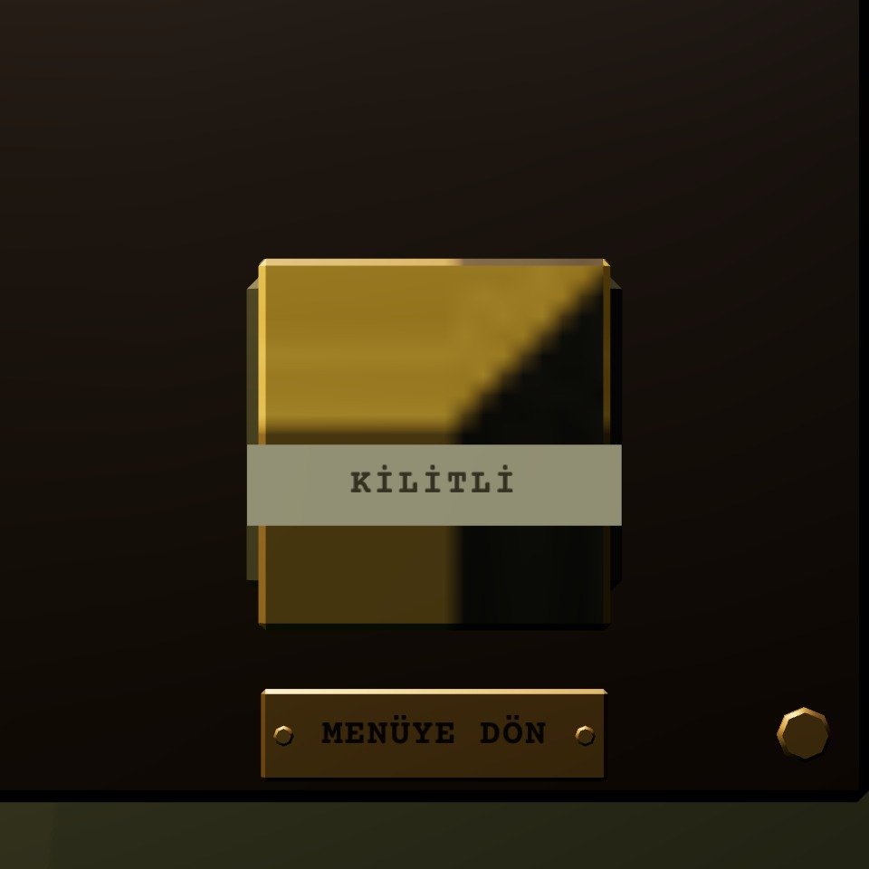
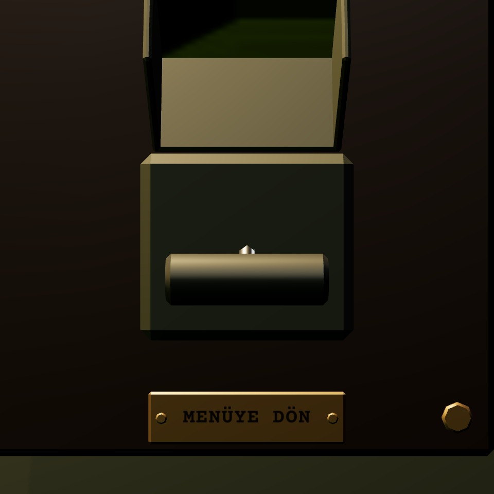

# R3f · Kontrollerin durumları
*Pano: `R3f.dc.html` · görüntü: `../panolar/R3f.jpg`*

R3f · KONTROLLERİN DURUMLARI K9 YAKIN · KOL BAŞI 25 MM · 1 PX ≈ 0,64 MM (OYUNDA)

NORMAL
Kol yarıkta, değer sayaçta ve ibrede; lamba değer > 0 ve ses açıksa yanık.

MÜZİK · %100 sürükle
ÜZERİNDE
Kol başı 4 mm öne (0,15 s), 400 ms sonra etiket. Tab odağı aynı görünür. İmleç el.

MÜZİK · %60 %5 adım · tık
SÜRÜKLENİYOR
Kol 6 mm öne (tutuldu); imleç yarığa izdüşer; etiket canlı, teker döner, ibre yaylı izler; her %10'da 1 mm oturma + tık.

MENÜYE DÖN önce kâğıdı kapat
DEVRE DIŞI
Masa meşgulken (baskın, geçiş, açık kâğıt) KİLİTLİ bandı; kapak açılmaz, tıklayınca 2 mm oynar ve “klak”.

MENÜYE DÖN · 2. TIK 4 sn · kayıt alınır
DİKKAT
Kapak 0,25 s'de 112° kalkar; 4 s içinde 2. tık kolu indirir (0,3 s), kayıt alınır, ekran kararır; süre dolarsa kapak kapanır.
- Basılı · sürgüde tutma = sürükleniyor; SES ve DİL'de kol/düğme 0,08–0,12 s'de yeni konuma geçer, aradaki basılı an 2 mm geri. | Yetersiz kaynak · dolapta yok (bütün değerler serbest). Çift tık kanalı varsayılana döndürür (genel %80, öteki %100). | Klavye · Tab/Shift+Tab kontroller arasında, ↑/↓ ±%5, ←/→ dil; Esc kapatır. Ekranda ipucu yazmaz.
