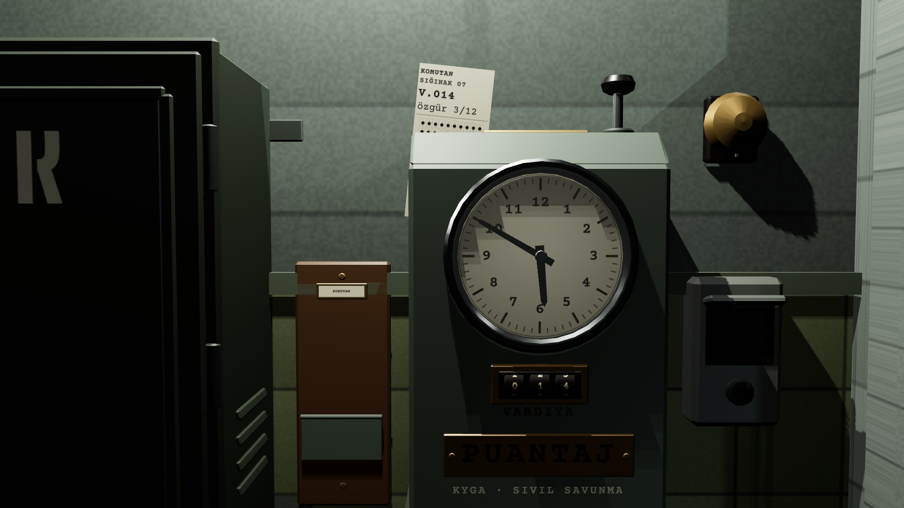
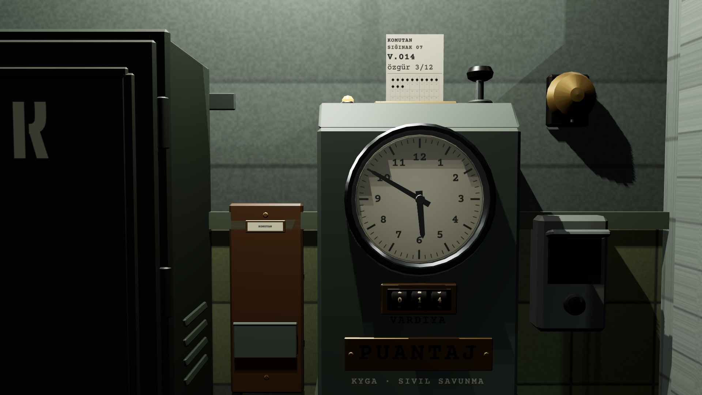
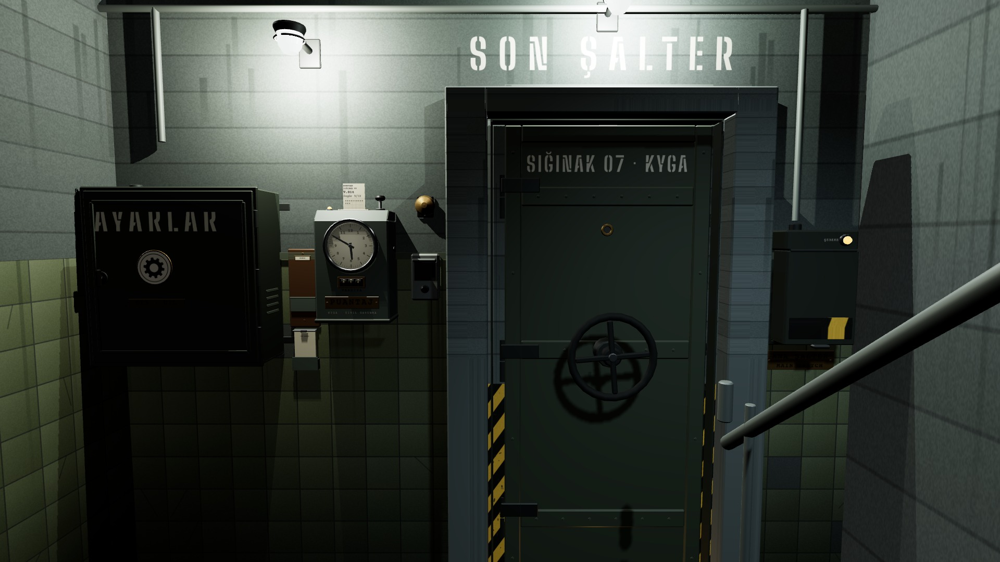
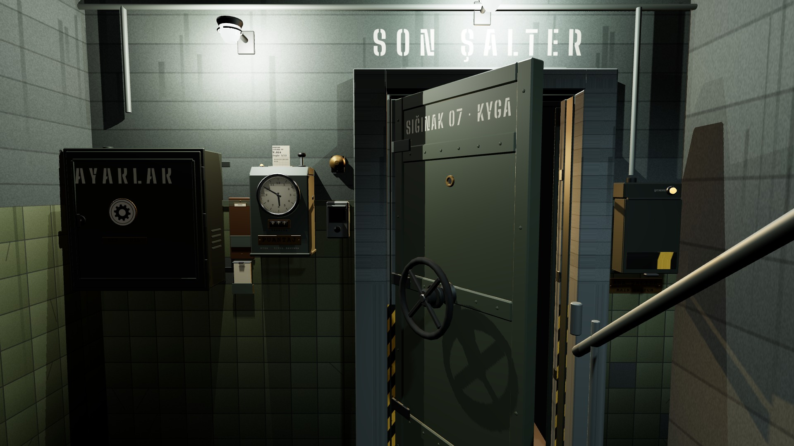
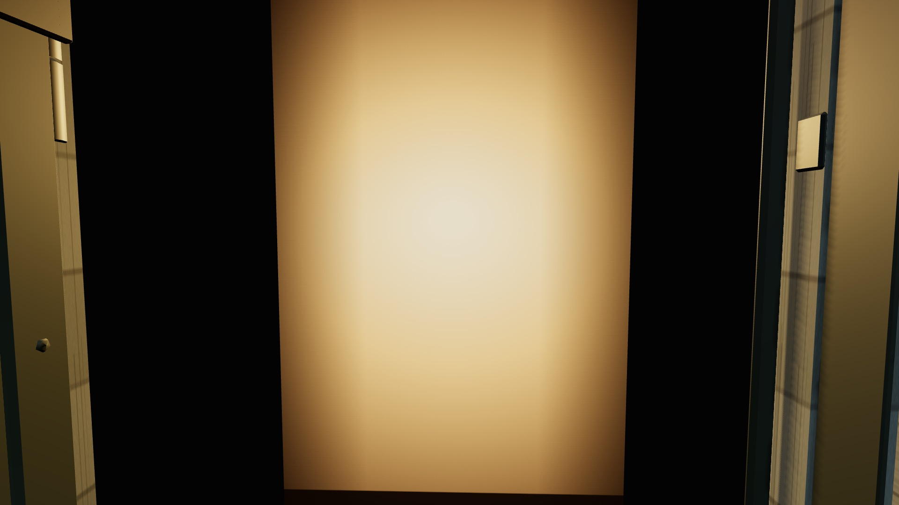
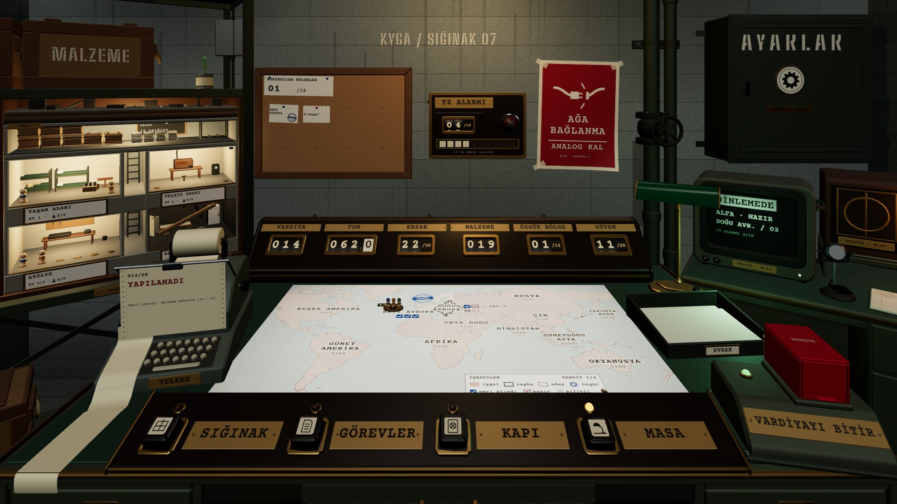

# R4 · İçeri girme anı · sekans
*Pano: `R4.dc.html` · görüntü: `../panolar/R4.jpg`*

R4 · İÇERİ GİRME ANI · KART → ZİL → KAPI → EŞİK → KARARMA → AMPUL ≈ 5,1 S · GİRDİ KİLİTLİ · ATLAMA YOK

0,00 1 · KART KALKAR
Cepten 0,12 s; 0,40 s'de yay çizerek saatin boğazına (tepe 8 cm, −6° yatar). Karton sürtmesi.

0,52 2 · KA-ÇUNK
Yarığa 70 mm (0,14 s); piston −12 mm (0,10 s); yeni delik 0,30 s; amber lamba yanar.

0,96 3 · ZİL · ÇARK
Zil 0,35 s, kamera M2 → M0 (0,45 s); 1,41'de dış çark 1,25 tur (0,50 s), üç “klonk”.

1,91 4 · KANAT AÇILIR
+95° (0,80 s), menteşe gıcırtısı; sıcak ışık 0,30 s'de yayılır; DeskGame yüklenmeye başlar.

2,71 5 · EŞİK (M3)
Kamera kapı ekseninde sabit hızla yürür (1,60 s), 0,2 m alçalır; jeneratör vınlaması yükselir.
SİYAH ≥ 0,20 S
4,01 6 · KARARMA
Eşiğin son 0,30 s'si; sahanlık uğultusu kesilir, yükleme siyahın arkasında biter.

4,51 7 · AMPUL
DeskGame: siyahtan ampul iki kırpışmayla (0,60 s); masa lambası henüz sönük. “Tık.”

*[görüntü: Komuta odası K1, bütün ışıklar yanık, masa hazır]*

5,26 8 · MASA (K1)
Masa lambası +0,15 s; teleks “V.014 · VARDİYA” basar. Devam: emir belgesi yok.
