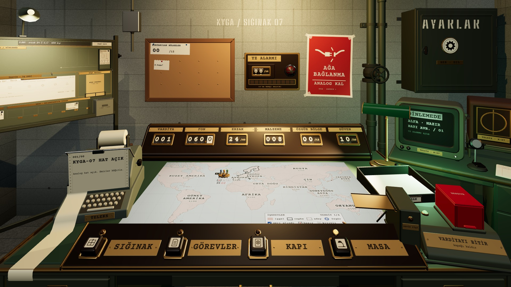
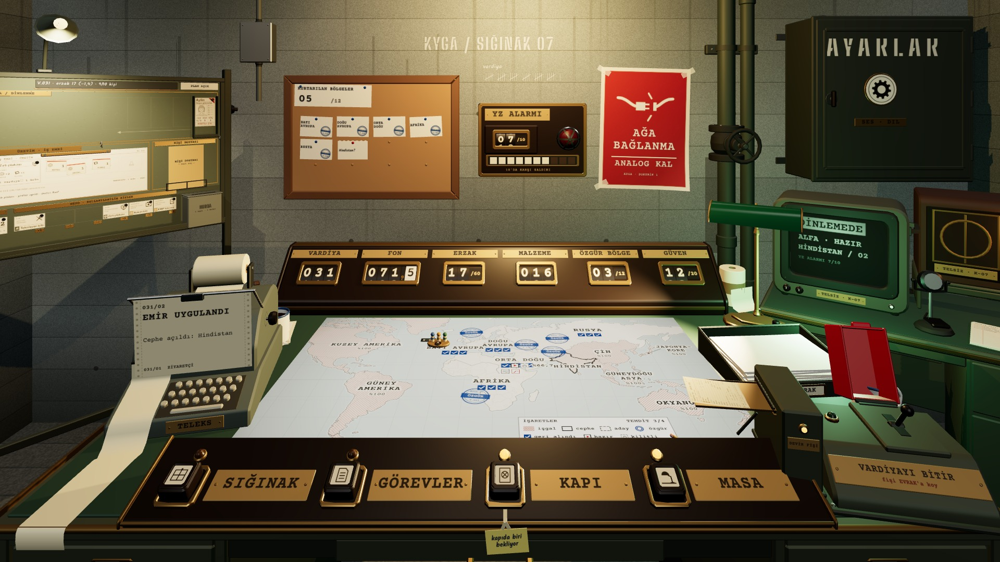

# R5 · K1 · ilk vardiya ve geç harekât (pano solda, fiş bekliyor)
*Pano: `R5a.dc.html` · görüntü: `../panolar/R5a.jpg`*

R5 · KOMUTA ODASI (K1) · İLK VARDİYA VE GEÇ HAREKÂT PANO SOLDA (ESKİ RAF YERİ) · ŞALTER HAZIR / FİŞ BEKLİYOR

V.001 İLK VARDİYA
Sol arka köşede ayaklı pano yandan ve küçük: lambası, sağ dikmesi, dolu cepleri ve Boşta tepsisi seçilir. Sayaçlar ERZAK 24/60, MALZEME 008 (3 + 2 + 2 + 1). Şalter hazır, fiş ağzı sönük.

V.031 GEÇ HAREKÂT · FİŞ BEKLİYOR
Şalter inik, kapak açık, hazır lambası sönük; fiş ağzının amber lambası yanık, fiş dilde. Plaka “fişi EVRAK’a koy”. Pano kilitli (fiş basıldı).
- Pano K1’de · ekranın sol üst çeyreğinde değil, ~%23 genişlikte ve yandan; tık ya da SIĞINAK tuşu K4’e götürür. | Sayaçlar · ERZAK kesri /60 (önce /30); MALZEME dört hammaddenin toplamı. | Şalter · R19’daki dört durum; K1’den ikinci satır okunur (~14 px). | Kalanlar · harita, teleks, anahtar rayı, CRT, ayarlar dolabı R1–R4’teki gibi.
