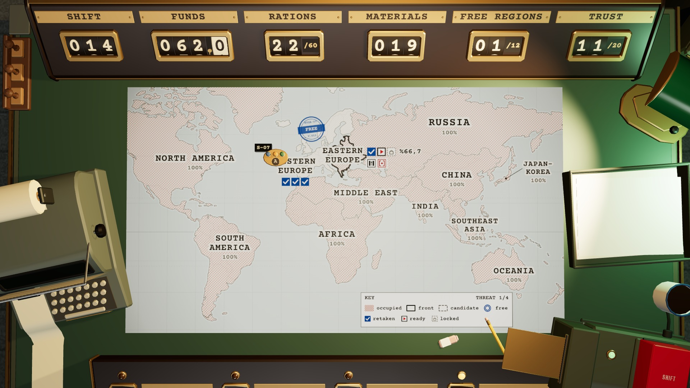

# R6 · Map, mission slip, roster report · EN
*Pano: `R6-EN.dc.html` · görüntü: `../panolar/R6-EN.jpg`*

KYGA · OPERATION FORM
No. OP-02
Esc
EASTERN EUROPE STATE ARCHIVE · SECTOR 1/3 · OCCUPIED 66.7%
*Şema:* Dar koridor işareti
REGION
Narrow corridor
*Şema:* Kilitleyici işareti
SIGNATURE
Locker
*Şema:* Tehdit kademesi 1/4
THREAT

### 1/4
*Şema:* Geri alındı
01 Microfilm store
LOOT
RETAKEN
*Şema:* Baskına hazır
02 File floor
LOOT
READY TO RAID
*Şema:* Kilitli
03 Scanning room
SERVER DEMOLITION
LOCKED
MISSION · 02 FILE FLOOR
Move the Technician next to the supply crate. Select the ability with Q, then click the crate to take the supplies.
- **COST** — 12 funds
- **REWARD** — +10 funds +6 rations +3 metal +2 circuit +2 cloth +1 chemical

*Şema etiketleri:* A
FIELD SQUAD · TEAM ALPHA
READY
T
Deniz
HP
2/2
MOVE
STR
Technician kit · Armour plate
E
Cem
HP
2/2
MOVE
STR
EMP kit · Armour plate · EMP cell
A
Zeynep
HP
2/2
MOVE
STR
Analysis kit · Care kit

### Enter ORDER THE RAID −12 funds
KYGA · SQUAD REPORT No. OP-02 · S.014
TEAM ALPHA EASTERN EUROPE · 02 FILE FLOOR
FIELD SQUAD ITEMS
T
Deniz Mechanic's apprentice
HP
2/2
MOVE
STR
- KIT Technician kit | ARMOUR Armour plate | AID —

HEALTHY
E
Cem Former security guard
HP
2/2
MOVE
STR
- KIT EMP kit | ARMOUR Armour plate | AID EMP cell

HEALTHY
A
Zeynep Maths teacher
HP
2/2
MOVE
STR
- KIT Analysis kit | ARMOUR — | AID Care kit

HEALTHY
Anyone left behind dies for good; their skill and items are lost.

### Enter LAUNCH THE RAID −12 funds
Esc cancel · back to the slip
