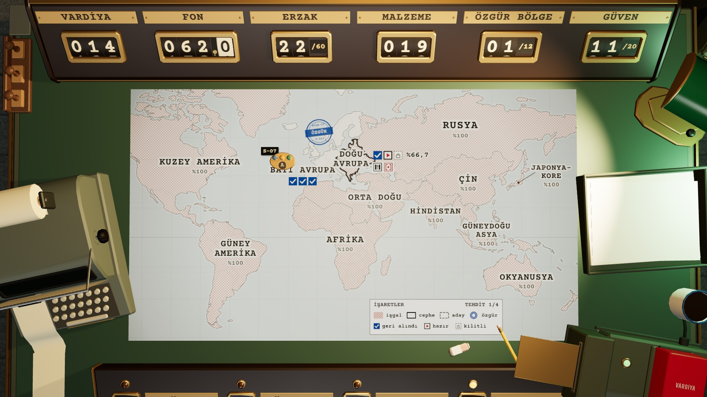

# R6 · Harita, görev fişi, kadro raporu · TR
*Pano: `R6-TR.dc.html` · görüntü: `../panolar/R6-TR.jpg`*

KYGA · HAREKÂT FORMU
No. OP-02
Esc
DOĞU AVRUPA DEVLET ARŞİVİ · SEKTÖR 1/3 · İŞGAL %66,7
*Şema:* Dar koridor işareti
BÖLGE
Dar koridor
*Şema:* Kilitleyici işareti
İMZA
Kilitleyici
*Şema:* Tehdit kademesi 1/4
TEHDİT

### 1/4
*Şema:* Geri alındı
01 Mikrofilm deposu
YAĞMA
GERİ ALINDI
*Şema:* Baskına hazır
02 Dosya katı
YAĞMA
BASKINA HAZIR
*Şema:* Kilitli
03 Tarama odası
SUNUCU YIKIMI
KİLİTLİ
GÖREV · 02 DOSYA KATI
Teknisyeni ikmal kasasının yanına götür. Q ile yeteneği seç ve kasaya tıklayarak malzemeleri al.
- **BEDEL** — 12 fon
- **ÖDÜL** — +10 fon +6 erzak +3 metal +2 devre +2 kumaş +1 kimyasal

*Şema etiketleri:* A
SAHA KADROSU · EKİP ALFA
HAZIR
T
Deniz
CAN
2/2
HAR
GÜÇ
Teknisyen kiti · Zırh plakası
E
Cem
CAN
2/2
HAR
GÜÇ
EMP kiti · Zırh plakası · EMP hücresi
A
Zeynep
CAN
2/2
HAR
GÜÇ
Analiz kiti · Bakım kiti

### Enter BASKIN EMRİ VER −12 fon
KYGA · KADRO RAPORU No. OP-02 · V.014
EKİP ALFA DOĞU AVRUPA · 02 DOSYA KATI
SAHA KADROSU EŞYA
T
Deniz Tamirci çırağı
CAN
2/2
HAR
GÜÇ
- KİT Teknisyen kiti | ZIRH Zırh plakası | YARDIMCI —

SAĞLAM
E
Cem Eski güvenlik görevlisi
CAN
2/2
HAR
GÜÇ
- KİT EMP kiti | ZIRH Zırh plakası | YARDIMCI EMP hücresi

SAĞLAM
A
Zeynep Matematik öğretmeni
CAN
2/2
HAR
GÜÇ
- KİT Analiz kiti | ZIRH — | YARDIMCI Bakım kiti

SAĞLAM
Geride kalan kişi kalıcı ölür; ustalığı ve eşyası kaybolur.

### Enter BASKINA ÇIK −12 fon
Esc vazgeç · görev fişine dön
