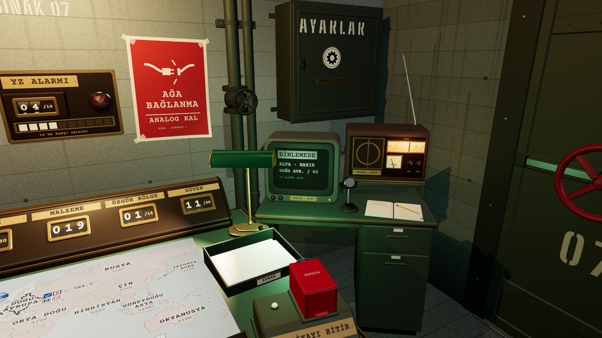

# R8a · CRT ve telsiz (K5a)
*Pano: `R8a.dc.html` · görüntü: `../panolar/R8a.jpg`*

DALIŞ 1 KARESİNDEN · 2× · TELSİZİN YÜZÜ
R8a · CRT VE TELSİZ K5a · 46° · 2 GÖLGELİ
- 1 | Kasa · kaput geriye daralır | 9 | PTT bas-konuş kolu · −8°
- 2 | Derin bezel 32 mm · vidalar | 10 | Kayıt defteri · TELSİZ KAYDI
- 3 | Bombeli ekran · UV 0–1 | 11 | Hoparlör bezi · pirinç halka
- 4 | İki bakalit düğme | 12 | KANAL skalası · arkadan ışıklı
- 5 | Plaka · TELSİZ · K-07 (TMP) | 13 | DialPointer · ±90 mm kayar
- 6 | Hazır LED'i · yeşil, swap | 14 | SİNYAL ibresi · ±50°
- 7 | Ahşap telsiz · ceviz kasa | 15 | SES · AYAR düğmeleri · ±150°
- 8 | Mikrofon · krom kafa, döküm kaide | 16 | Teleskop anten · 3 boğum

Ekran Rev2'deki gibi: DİNLEMEDE ters video, dört satır. Yeni ölçülerde K5a telsizin sağ yarısını kesiyor; yüzü dalış 1 karesinden büyütüldü (sol üst). Kamera önerisi R8 notunda.
