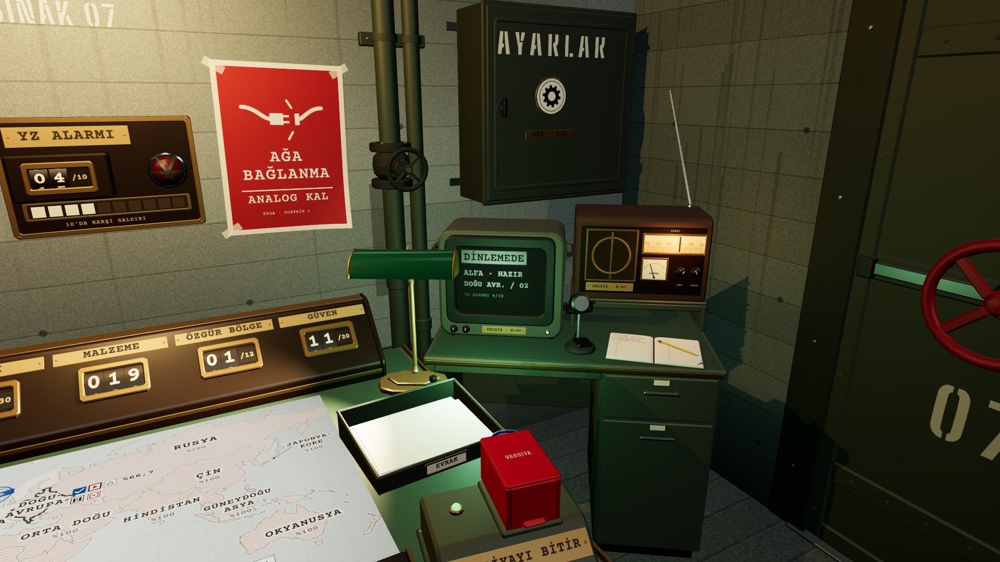
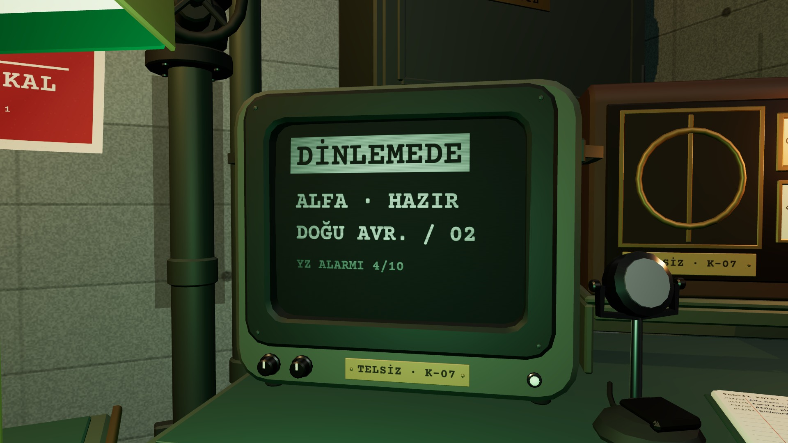
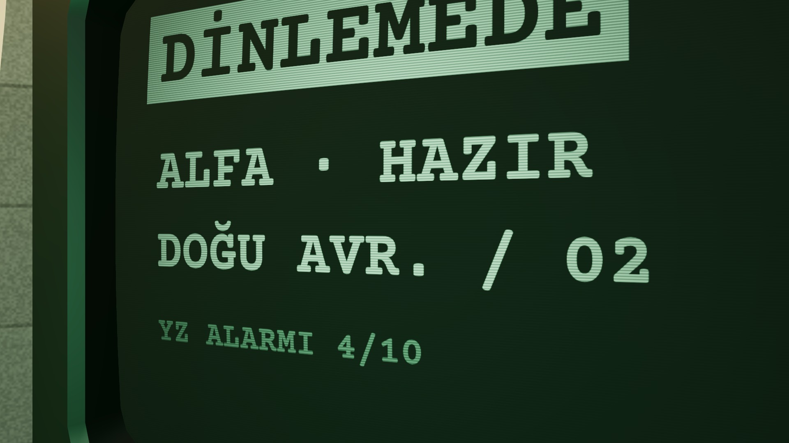

# R8b · Dalış anı
*Pano: `R8b.dc.html` · görüntü: `../panolar/R8b.jpg`*

R8b · DALIŞ ANI · 2,4 S motion.crtDiveS 2,4 · tek ve kesintisiz hareket: geri çekil → CRT'ye dön → ekrana yaklaş

*[görüntü: Başlangıç: K1 pozu, masa, sayaç rafı, harita, anahtar rayı; sağda CRT ve dolap]*

0,0 s K1 · EMİR
HAREKET
EMRİ İLET'ten 0,3 s sonra kamera kalkar. Emir harita pozunda verildiyse yol oradan başlar; burada K1.
SES
Röle tıkı; oda uğultusu sürer.

≈ 0,8 s DALIŞ 1
HAREKET
Geri çekilmiş, sağa CRT'ye dönüyor; alarm panosu, afiş, dolap ve kapı kadrajdan geçer.
SES
Uğultu alçalır, tüp vınlaması başlar.

≈ 1,6 s K5a
HAREKET
CRT'nin önünden geçer, yaklaşma sürer; DİNLEMEDE okunur, telsiz kadranı yanık.
SES
Telsiz cızırtısı yükselir (SES düğmesinin değeriyle).

≈ 2,2 s DALIŞ 3
HAREKET
Ekran kadrajı doldurur; 1,8 s'den beri ekran emission'ı ve ScreenLight 1 → 1,4×.
SES
Cızırtı tepede, vınlama keskinleşir.
HAT AÇILIYOR K-07 · DOĞU AVR. / 02 5
2,4 s KESME
HAREKET
Fosfor tam kare: HAT AÇILIYOR (satır 0,15 s, senkron kutusu 0,1 s); Baskın sahnesi odanın üstüne yüklenir.
SES
Röle “klak”, cızırtı kesilir; baskın ortam sesi girer.
ZAMAN ÇİZELGESİ · 0 → 2,4 S vuruşlar üst üste biner; kesirler örnek, değerler SiginakCameraRig'de
0,4
0,8
1,2
1,6
2,0
2,4
geri çekil
CRT'ye dön
ekrana yaklaş
emission ×1,4
vınlama · cızırtı
hat → baskın
- DÖNÜŞ Sonuç kartı kapanınca tüp kapanır (beyaz çizgi → nokta); kamera bu sırada 0,3 s ekranda bekler (crtReturnDelayS), sonra aynı yolun tersiyle harita pozuna döner. Ekran DİNLEMEDE'ye geçer. | ATLAMA VE DURUM Tık (ya da boşluk) dalışı atlar: kamera son kareye, emission 1,4×, kesme. Dalış boyunca oda tıklanmaz, anahtar rayı kilitli; ekranda yazı yok. | IŞIK Ampul ve masa lambası gölgeli (2); CRT sızıntısı #7FD9A0 ve telsiz kadranı gölgesiz. Parlama yalnız emission: bloom yok, post-processing kapalıyken de aynı.
