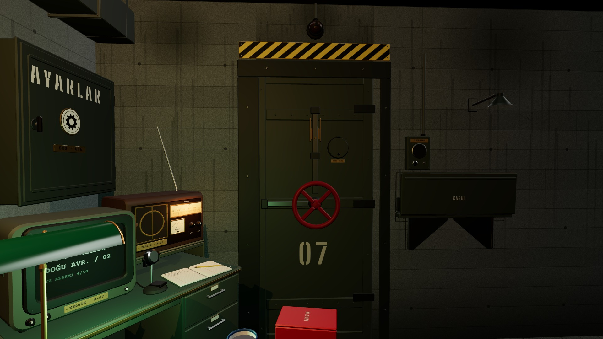

# R9a · Kapı kapalı · aday çaldı
*Pano: `R9a.dc.html` · görüntü: `../panolar/R9a.jpg`*

BAŞVURU YOK · TEZGÂH KATLI
R9a · KAPI KAPALI · ADAY GELDİ K8 · 60° · 3 GÖLGELİ
- 1 | Kanat · perçinli çelik, iki yüz | 8 | Menteşeler ×3 · odadan görünür
- 2 | El çarkı · kırmızı, 1,25 tur | 9 | İç interkom · GÖRÜŞME
- 3 | Vuruş lambası · amber: aday var | 10 | Kabul tezgâhı · indi
- 4 | Tehlike bandı · 1,10 × 0,12 | 11 | Evrak gözü · belge geldi
- 5 | Gözetleme deliği · sürgülü kapak | 12 | Karar damgaları ×4
- 6 | Buğu camı · yeni (R17) | 13 | Tezgâh lambası · yandı
- 7 | 07 şablonu | 14 | Kasa · 0,25 m beton söve

Üç vuruş, lamba amber; tezgâh iner, evrak gözünden belge gelir. Siluet yok: kim olduğu belgeden ve incelemeden anlaşılır. Sağ alt: başvuru yokken tezgâh katlı, lamba sönük.
