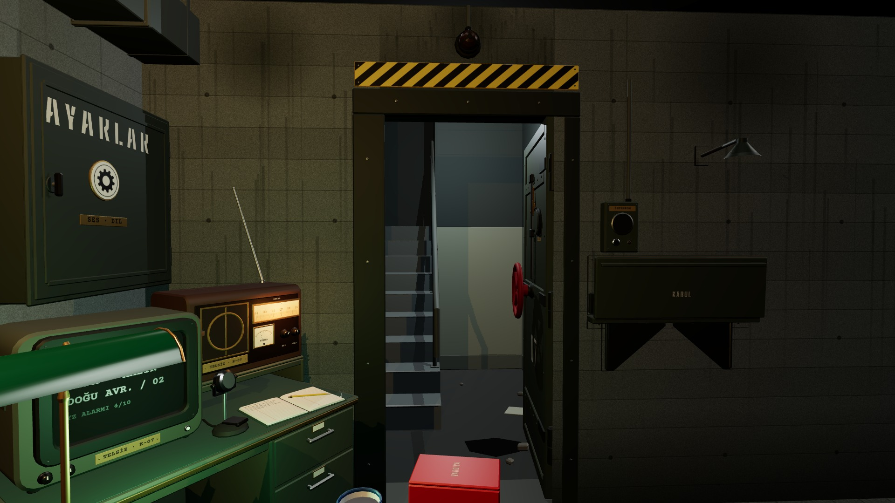

# R9b · Kapı açık · koridor
*Pano: `R9b.dc.html` · görüntü: `../panolar/R9b.jpg`*

R9b · KAPI AÇIK · KORİDOR BOŞ K8 · 60° · 3 GÖLGELİ
- 1 | Kanat · koridora 95° | 6 | Beton söve · 0,25 m
- 2 | Çark · kanatla döndü (1,25 tur) | 7 | Vuruş lambası · sönük
- 3 | Merdiven · 9 basamak 0,17/0,26 | 8 | Kabul tezgâhı · katlı
- 4 | Koridor ışığı · üstten, gölgeli | 9 | Menteşe ekseni · kalınlığın ortası
- 5 | Sahanlık · ıslak beton, birikinti

KABUL damgasından sonra çark 0,5 s, kanat 0,8 s; merdiven ışığı 0,3 s yanar. Kabul edilen kişi görünmez: koridor boş kalır, kartı panoya düşer. Merdiven kuyusu x ≈ 5,8’e uzanır: menü sahanlığıyla tek “Sahanlık” prefab’ı önerisi notta.
